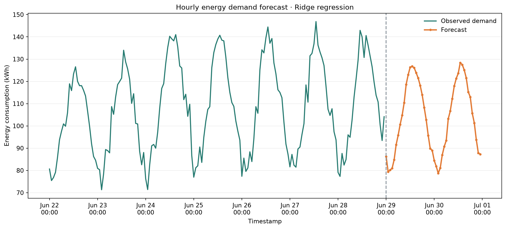
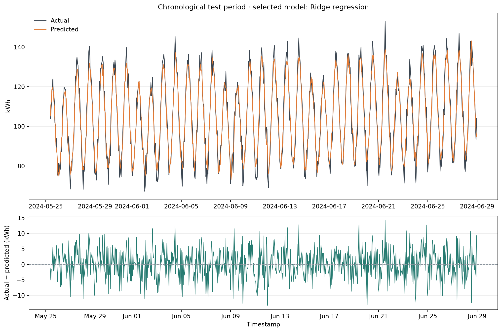
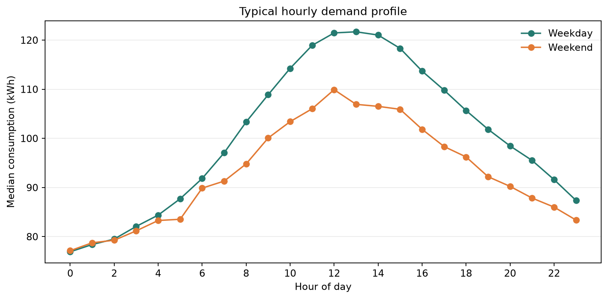

# AI-Powered Energy Consumption Forecasting System

A beginner-friendly, reproducible Python project that compares time-aware
forecasting models on hourly energy readings, forecasts the next 48 hours, and
creates charts and a transparent cost scenario. It runs without real corporate
meter access: the default dataset is deterministic synthetic facility data.

> **Important:** Synthetic data is for learning and workflow demonstration. It
> is not evidence of a real building's consumption, forecast accuracy, or
> energy savings.

## Quick start

Python 3.11 is recommended; Python 3.10 or newer is supported. From this directory:

```bash
python -m venv .venv
```

Activate the environment, then install packages:

```bash
# Windows PowerShell
.\.venv\Scripts\Activate.ps1
python -m pip install -r requirements.txt

# macOS / Linux
source .venv/bin/activate
python -m pip install -r requirements.txt
```

Run the complete simulation:

```bash
python main.py
```

The default command generates 180 days of hourly demo readings, trains and
compares the models, scores a chronological test period, saves the best model,
forecasts the next 48 hours, and creates business-facing outputs.

## Tech-stack decision

The project guide compares three paths: (A) a minimal Pandas/Linear Regression
setup, (B) scikit-learn Ridge + Random Forest against a seasonal baseline, and
(C) an advanced LSTM/GRU sequence model. This repository implements **Option B**:
it is CPU-friendly, quick to run, and produces a clear model comparison without
requiring a GPU. See [the detailed comparison](docs/architecture.md#beginner-friendly-stack-choices).

## What the project does

- Generates an hourly simulation with production-shift, weekday/weekend,
  temperature, trend, and noise patterns.
- Accepts a CSV with `timestamp` and `consumption_kwh`, with optional
  `outdoor_temp_c`.
- Cleans invalid rows, aggregates duplicate timestamps, sorts observations, and
  interpolates only short interior gaps.
- Creates prior-hour, prior-day, prior-week, shifted rolling, calendar-cycle,
  and temperature features.
- Compares a 24-hour seasonal-naive baseline, Ridge regression, and Random
  Forest regression using an ordered 80%/20% train/test split.
- Reports RMSE, MAE, and R², and selects the lowest holdout-RMSE candidate.
- Saves holdout predictions and metrics, refits the winner on all known
  history, and creates a recursive hourly forecast.
- Produces an illustrative energy cost using the flat tariff you provide.

## Example commands

```bash
# Re-run training and create a 72-hour forecast
python main.py --mode all --horizon 72 --tariff 9.5

# Train and save evaluation/model files only
python main.py --mode train --days 240

# Create future predictions from the previously saved model
python main.py --mode forecast --horizon 24

# Use your own hourly interval-energy CSV
python main.py --input data/raw/my_hourly_meter.csv --horizon 48 --tariff 7.25

# Choose another deterministic synthetic dataset
python main.py --days 365 --seed 7
```

`--tariff` is a cost per kWh in whichever currency unit you choose. The tool
does not infer a real utility rate or calculate verified savings. `--horizon`
accepts 1–720 hours. `--days` must be at least 30.

## Virtual simulation walkthrough

1. **Create a simulated facility:** the generator makes hourly kWh readings
   with weekday production shifts, lower weekend activity, temperature-related
   HVAC load, a gradual trend, and random measurement noise.
2. **Treat each row like an interval meter record:** the timestamp identifies
   the hour and `consumption_kwh` is the energy used during it. This resembles
   the shape of an hourly meter export, but it is not a real site's data.
3. **Replay model selection:** the latest 20% of readings act as a historical
   holdout. The baseline and ML candidates predict this period in time order.
4. **Make a planning forecast:** after selecting and refitting a candidate,
   the application recursively predicts the next 48 hours by default.
5. **Translate demand into a simple scenario:** the report multiplies predicted
   kWh by the flat `--tariff` value and flags hours above the historical 90th
   percentile. A facilities analyst could use those hours to review flexible
   loads, shifts, or capacity; the program does not control equipment.
6. **Save proof:** inspect the metric JSON and holdout CSV, then share the
   forecast, evaluation, and weekday/weekend profile charts from `images/`.

To replace the virtual meter, provide a permitted public or organization-owned
CSV in the documented format. Check its license, units, time zone, frequency,
and missing intervals first. Convert cumulative meter counters or sub-hourly
data to hourly interval kWh before using this starter pipeline.

## Expected outputs

After the default run:

```text
data/raw/synthetic_energy.csv
models/model_metadata.json
models/best_model.joblib             # only when an ML model wins
outputs/model_metrics.json
outputs/holdout_predictions.csv
outputs/next_48_hours_forecast.csv
outputs/business_simulation.json
images/model_evaluation.png
images/hourly_demand_profile.png
images/energy_forecast.png
```

### Forecast and model evaluation



### Holdout evaluation



### Typical operating profile



Holdout metrics vary if the input, seed, or model settings change. Interpret
RMSE and MAE in kWh; R² can be negative when a model performs worse than a
constant-mean prediction. Always compare against the seasonal baseline. This
project does not promise a particular score.

For reference, one run with the default generated data (180 days, seed 42)
selected Ridge regression: seasonal-naive RMSE 7.30 kWh / R² 0.865, Ridge RMSE
4.68 kWh / R² 0.944, and Random Forest RMSE 5.36 kWh / R² 0.927. These are
example results on this deterministic simulation, not a real-site performance
claim.

## Input CSV format

Use hourly interval energy (kWh per row), with a parseable timestamp:

```csv
timestamp,consumption_kwh,outdoor_temp_c
2025-01-01 00:00:00,82.4,18.2
2025-01-01 01:00:00,77.9,17.7
```

If you do not have temperature readings, omit `outdoor_temp_c`. A simple proxy
is used and is clearly an assumption. The project expects one row per hour; it
does not silently convert cumulative meter counters or instantaneous kW into
interval kWh. Provide at least 30 days of continuous hourly readings; longer
history is better for capturing annual and seasonal patterns.

## Repository map

```text
energy-forecasting/
├── data/
│   ├── raw/                 # Local source/demo CSV; generated CSV is ignored by Git
│   └── processed/           # Optional cleaned datasets
├── notebooks/               # Optional exploration; production logic stays in src/
├── src/energy_forecasting/
│   ├── data.py              # Synthetic generator and input cleaning
│   ├── features.py          # Leakage-aware feature creation
│   ├── modeling.py          # Baseline, ML evaluation, metrics, saved model
│   ├── forecasting.py       # Recursive future prediction and cost scenario
│   └── visualization.py     # Saved PNG charts
├── models/                  # Local model artifact and metadata
├── outputs/                 # CSV predictions and JSON reports
├── images/                  # Charts and portfolio evidence
├── docs/
│   ├── architecture.md      # Plain-language + technical explanation
│   ├── implementation-plan.md
│   └── github-and-placements.md
├── tests/
├── main.py
├── requirements.txt
└── .gitignore
```

`main.py` handles CLI options and the workflow. `requirements.txt` lists the
Python libraries needed to repeat it. `.gitignore` excludes local raw CSVs and
binary model files, while allowing small reports and charts to serve as
reviewable evidence. `data/` holds raw and optional processed inputs;
`notebooks/` is for optional exploration; `models/` stores local model
artifacts; `outputs/` stores machine-readable results; `images/` stores charts;
and `docs/` contains the technical and portfolio guides.

## Learn the project

- [Architecture and project explanation](docs/architecture.md): problem,
  industry uses, technical workflow, diagram, modules, and data limitations.
- [Ten-phase implementation plan](docs/implementation-plan.md): setup to final
  output, with expected results and checks for each phase.
- [GitHub and placements guide](docs/github-and-placements.md): repository
  setup, commit strategy, evidence checklist, and interview explanation.

## Run the tests

```bash
python -m unittest discover -s tests -v
```

The tests cover repeatable simulation, duplicate/gap cleaning, lag construction,
chronological evaluation, and forecast/cost output.

## Modeling notes and limitations

This is a one-hour-ahead supervised regression exercise, followed by recursive
multi-step forecasting. The holdout test uses actual prior observations for
lag features, as in rolling one-step-ahead evaluation. During the future
forecast, later lag values are generated from earlier predictions, so errors
can accumulate over longer horizons. The future temperature feature is
estimated from recent same-hour measurements, not an external weather service.

Before operational use, add real data permissions, unit and time-zone checks,
holiday and planned-shutdown inputs, weather forecasts, uncertainty intervals,
drift monitoring, human review, and an evaluation that matches the actual
decision schedule. Forecasts support decisions; they do not automatically
control equipment or prove savings.

## License and data

No external dataset is bundled. The default generated data is synthetic and can
be reproduced from the source and random seed. Add a license and source
attribution appropriate to your use before publishing a public dataset.
